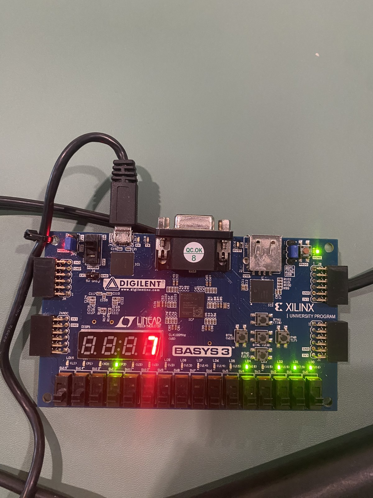

# FPGA Neural-Network Digit Classifier

A small MNIST digit classifier (784 → 32 → 10, int8 weights) implemented in SystemVerilog on a Digilent Basys 3 FPGA.

## Goal

Build a complete, measurable hardware inference pipeline: train a small model in Python, quantize it to int8, and run it on an FPGA using a MAC unit, block RAM for weights, a state-machine controller, ReLU, and argmax. Images are sent to the board over UART and the predicted digit is shown on the seven-segment display.

The project emphasizes clean SystemVerilog, self-checking testbenches, a bit-exact integer golden model, and measured results (accuracy, cycle count, resource usage, clock speed).

## Demo



A PC streams MNIST test images to the board over USB-UART; the FPGA classifies each one and shows the digit on the seven-segment display. Over all 10,000 test images the board's answers matched the Python integer model exactly (96.73% accuracy).

## Hardware and Tools

- **Board:** Digilent Basys 3 (Artix-7 XC7A35T-1CPG236C)
- **FPGA toolchain:** Xilinx Vivado 2026.1 (xsim for simulation)
- **Hardware language:** SystemVerilog
- **Training and golden model:** Python 3.13 (PyTorch, NumPy)
- **Development environment:** Windows, Git Bash, VS Code

## Roadmap

- [x] 1. Basics: UART, LEDs, and seven-segment display verified on hardware (the standalone switches-to-LEDs warm-up was simulated only)
- [x] 2. Train a small model in Python (96.70% test accuracy, float32)
- [x] 3. Quantize to int8, write a pure-integer golden model, export `.mem` weights (96.73% test accuracy)
- [x] 4. One MAC unit with a self-checking testbench
- [x] 5. One layer with a single MAC, compared to the golden model
- [x] 6. Full network in simulation: 100/100 predictions match the golden model
- [x] 7. Run on the board over UART: 96.73% accuracy on all 10,000 test images, identical to the golden model
- [x] 8. Parallel MACs (1, 4, 8, 16): up to 15.8x lower latency (1,623 cycles) for 26 DSPs; see the table below

## Results

Measured so far (Python, simulation, Vivado, and on the board):

| Metric | Result | Measured by |
| --- | --- | --- |
| Float32 test accuracy (10,000 images) | 96.70% | `python/train.py` |
| Int8 test accuracy (10,000 images) | 96.73% | `python/golden.py` |
| Float vs. int8 prediction agreement | 99.85% | `python/golden.py` |
| Hardware vs. golden model (simulation) | 100/100 predictions identical | `tb/tb_network.sv` |
| Latency, one MAC per layer | 25,587 cycles per image | `tb/tb_network.sv` |
| Latency at the board's 100 MHz clock (timing met with margin) | about 256 µs per image | derived from cycle count |
| Accumulator width needed (worst case) | 26 bits (layer 1), 21 bits (layer 2) | analysis |
| Resources, `network` module only (post-route, out-of-context) | 1,484 LUTs (7.1%), 1,326 registers (3.2%), 9 BRAM tiles (18%), 2 DSPs (2.2%) | `scripts/sweep.sh` |
| Timing, `network` module at a 125 MHz target (8 ns) | Met, worst setup slack +0.794 ns | `scripts/sweep.sh` |
| Resources, full board design (post-route) | 1,586 LUTs (7.6%), 1,465 registers (3.5%), 9.5 BRAM tiles (19%), 2 DSPs (2.2%) | `scripts/build.sh` |
| Timing, full board design at 100 MHz | Met: setup slack +1.563 ns, hold slack +0.164 ns | `scripts/build.sh` |
| On-board accuracy, 10,000 MNIST test images over UART | 96.73% (9,673/10,000) | `python/send_images.py` |
| On-board vs. golden model | 10,000/10,000 predictions identical; 0 timeouts, 0 bad replies | `python/send_images.py` |
| End-to-end time per image over UART (measured) | 80.0 ms average; UART transfer alone is about 68 ms, network compute about 0.26 ms | `python/send_images.py` |

Network-only numbers come from an out-of-context run of the `network` module (Vivado 2026.1, Artix-7 -1 speed grade), which does not model clock-buffer delay or skew. The full-board numbers come from `scripts/build.sh`, which implements `board_top` with the real pin constraints and clock buffer.

### Multiplier mapping: LUTs vs. DSP blocks

_Both runs below used a 10 ns target, before the timing fix in the next section._

By default Vivado built the 8x9-bit multiplier from LUTs. Adding `(* use_dsp = "yes" *)` to `src/mac.sv` moves each MAC's multiply-add into a DSP48 block. The network has two MACs (one per layer), hence 2 DSPs.

| | LUT multiplier | DSP-mapped | Change |
| --- | --- | --- | --- |
| LUTs | 1,726 | 1,552 | -174 (-10.1%) |
| Registers | 1,183 | 1,103 | -80 (-6.8%) |
| Block RAM tiles | 9.5 | 9.5 | none |
| DSPs | 0 | 2 | +2 |
| Worst setup slack at 10 ns | +0.562 ns | +0.975 ns | +0.413 ns |
| Estimated max clock | 106.0 MHz | 110.8 MHz | +4.5% |

The clock gain is small, so the multiplier was not the only limit on speed; the critical path is examined in `docs/reports/critical_path.rpt`.

### Timing: critical-path fix

With DSP-mapped MACs the worst path at the 10 ns target (8.58 ns, 55% routing) ran from a stored layer-1 accumulator through the ReLU/shift/clamp logic and a 32:1 read mux into layer 2's DSP. Registering the 32 hidden activations splits that into two short paths. It costs 224 registers and no latency (the cycle count is unchanged at 25,587). The design then meets an 8 ns target (125 MHz) with +0.850 ns slack, and the critical path moves to the image block RAM feeding layer 1's DSP. The board clock is 100 MHz and the full board build meets it with margin, so no further clock tuning is planned; DSP-internal pipeline registers plus an MMCM would be the next step to run faster. (That measurement gave +0.850 ns slack; re-measured after the later parallel-MAC refactor the same configuration gives +0.794 ns, which is the figure in the table above. Small differences are expected when the netlist changes slightly and is placed and routed again.)

### Parallel MACs

Each layer can use P MAC units working on P neurons at once, sharing the input stream (P = 1 is the baseline above; layer 2 has only 10 outputs, so it uses min(P, 10) MACs). All variants pass the same end-to-end simulation against the golden model (100/100 predictions identical), and each testbench checks the exact cycle count. Resources and timing are from out-of-context synthesis of the `network` module at an 8 ns (125 MHz) target; latency is in clock cycles, converted at 100 MHz.

| MACs per layer (P) | Latency (cycles) | Speedup | Latency at 100 MHz | LUTs | Registers | BRAM tiles | DSPs | Setup slack at 8 ns | Est. max clock* |
| --- | --- | --- | --- | --- | --- | --- | --- | --- | --- |
| 1 | 25,587 | 1.00x | 255.9 µs | 1,484 | 1,326 | 9 | 2 | +0.794 ns | about 139 MHz |
| 4 | 6,423 | 3.98x | 64.2 µs | 1,476 | 1,368 | 9 | 8 | +0.578 ns | about 135 MHz |
| 8 | 3,235 | 7.91x | 32.4 µs | 1,438 | 1,323 | 9.5 | 16 | +0.434 ns | about 132 MHz |
| 16 | 1,623 | 15.77x | 16.2 µs | 1,433 | 1,335 | 10 | 26 | +0.037 ns | about 126 MHz |

\* Extrapolated from the slack as 1000 / (8 - slack) MHz; approximate, since the out-of-context run does not model clock skew.

- **Speedup is close to linear** (98.5% to 99.6% of ideal). Layer 1 is almost all of the P = 1 latency; what does not scale is a fixed 47 cycles at P = 16 (layer 2 plus start and argmax overhead) and 4 overhead cycles per group of neurons.
- **The cost is DSP blocks**, one per MAC: 26 of the 90 on this chip at P = 16. LUT and register counts stay roughly flat because the multiply-accumulate lives in the DSPs. Block RAM grows slightly (9 to 10 tiles) as the weight memory gets wider so that every MAC is fed each cycle.
- **Timing slack shrinks as P grows**, and P = 16 only just meets 125 MHz. All variants meet a clock faster than the board's 100 MHz.
- **On this board the UART is the bottleneck, not the network.** Sending an image takes about 68 ms; even the slowest variant computes it in 0.26 ms and the fastest in 0.016 ms. Parallel MACs would matter with a faster data source. The board run above used P = 1; the parallel variants are verified in simulation and synthesis only.

Per-variant reports are in `docs/reports/p1/`, `p4/`, `p8/`, and `p16/`, and the table is regenerated by `bash scripts/sweep.sh`.


## Architecture

```
image (784 x uint8) -> [image RAM] -> layer 1 (784 -> 32, one MAC) -> ReLU/shift/clamp
                                   -> layer 2 (32 -> 10, one MAC) -> argmax -> digit 0..9
```

- **Quantization:** int8 weights with one scale per layer; inputs stay as raw 0..255 pixel bytes; 32-bit biases and accumulators. Between layers the accumulator is rounded, shifted right by a constant (a power of two, so no multiplier is needed), and clamped to 0..127.
- **MAC unit** (`src/mac.sv`): signed 8-bit weight times signed 9-bit input, 32-bit accumulator, with a load input used to start each neuron at its bias.
- **Layer** (`src/layer.sv`): weights and biases are read from `.mem` files into block-RAM-style memories with a registered read. A state machine computes P neurons at a time with P parallel MAC units that share the input stream (P = 1 is the baseline), and takes ceil(N_OUT / P) × (N_IN + 4) cycles. One memory word holds the P weights for a group, so every MAC is fed each cycle. Layer 2 uses min(P, 10) MACs because it has only 10 outputs.
- **Argmax** (`src/argmax.sv`): sequential, one comparator, ties go to the lowest digit (same as NumPy).
- **UART receiver** (`src/uart_rx.sv`): 8N1 at 115,200 baud from the 100 MHz clock (868 clocks per bit), with a two-flop input synchronizer, mid-bit sampling, glitch rejection, and a framing-error flag.
- **UART loader** (`src/uart_loader.sv`): writes the 784 received bytes into the network's image memory, then starts the network. Framing errors, mid-image stalls (timeout), and bytes arriving while the network is busy discard the partial image so the stream always resyncs.
- **UART transmitter** (`src/uart_tx.sv`): same 8N1 format and baud generator as the receiver; sends the predicted digit back to the PC.
- **Seven-segment driver** (`src/seg7.sv`): shows the predicted digit (or "-" before a result) on the rightmost display digit.
- **Board top level** (`src/board_top.sv`): ties it together for the Basys 3. A PC sends 784 pixel bytes over the USB-UART; the board classifies the image, shows the digit on the seven-segment display, and replies with the digit as an ASCII character. LEDs show the last prediction, an image counter, and error/busy flags; the center button is reset.
- **Network** (`src/network.sv`): chains the pieces. Images are written in through a byte-wide write port, which the UART receiver will drive.

## Verification

Every testbench is self-checking and prints PASS or FAIL.

| Testbench | What it checks |
| --- | --- |
| `tb/tb_top.sv` | Switches-to-LEDs warm-up: fixed, walking-one, and random patterns |
| `tb/tb_mac.sv` | MAC against a reference model: priorities, worst-case sums, 200 random neurons (83,378 checks) |
| `tb/tb_layer1.sv` | Layer 1 against the Python golden model: all 32 raw accumulators and activations for 10 images, plus the exact cycle count; runs for any P |
| `tb/tb_network.sv` | Full network against the golden model on real MNIST test images, loaded through the write port, plus the exact latency formula; runs for any P |
| `tb/tb_uart_rx.sv` | UART receiver: all 256 byte values back-to-back, bad stop bit, glitch rejection, and the real 868-clock bit time |
| `tb/tb_uart_loader.sv` | UART loader: full image, start only after the last write lands, and recovery from a framing error, a stall, and a busy network |
| `tb/tb_uart_tx.sv` | UART transmitter: all 256 values decoded by an independent line decoder, exact busy time, send-while-busy ignored, real baud rate |
| `tb/tb_seg7.sv` | Seven-segment driver: every digit, the error pattern, and the blank state, specified by lit-segment letters |
| `tb/tb_board_top.sv` | Whole board end to end: real MNIST images sent over a serial line, checking the ASCII reply, display, and LEDs, including recovery from a framing error mid-image |

The golden model (`python/golden.py`) is pure integer arithmetic and reads the same `.mem` files the hardware loads. `python/export_vectors.py` writes its expected values into `tb/vectors/`.

## Repo Layout

| Folder | Contents |
| --- | --- |
| `python/` | Training, quantization, integer golden model, test-vector export, weight layouts for parallel MACs (`export_parallel.py`), on-board test script (`send_images.py`) |
| `weights/` | Quantized weights and biases (`.mem`), float model, `quant_params.json`; `p4/`, `p8/`, `p16/` hold the wide-word layouts for 4, 8, and 16 parallel MACs |
| `src/` | SystemVerilog design sources |
| `tb/` | Self-checking testbenches; `tb/vectors/` holds exported test vectors |
| `constraints/` | Basys 3 pin constraints: `board_top.xdc` (full build), `basys3.xdc` (old switches-to-LEDs warm-up) |
| `docs/` | Plots (`training_curve.png`) and Vivado synthesis/timing reports (`docs/reports/`) |
| `scripts/` | `create_project.tcl` (Vivado rebuild), `sim.sh` (run a testbench), `synth.sh` / `synth.tcl` (out-of-context synthesis and timing), `build.sh` / `build.tcl` (full board build and bitstream), `program.sh` / `program.tcl` (program the board) |
| `vivado_proj/`, `sim_build/`, `synth_build/` | Generated, git-ignored |

## How to Run

All commands run from the repo root in Git Bash. Adjust the Vivado path if yours differs.

**1. Python environment** (once)

```bash
python -m venv .venv
source .venv/Scripts/activate
pip install -r requirements.txt
```

**2. Train, quantize, and check the golden model**

```bash
python python/train.py
python python/quantize.py
python python/golden.py
python python/export_vectors.py 100
```

**3. Simulate** (point `VIVADO_BIN` at your Vivado `bin` folder if it is not the default)

```bash
bash scripts/sim.sh tb_mac
bash scripts/sim.sh tb_layer1
bash scripts/sim.sh tb_network

# parallel MACs: export the weight layouts once, then pass P
python python/export_parallel.py
P=4 bash scripts/sim.sh tb_network
```

**4. Synthesize and measure resources and timing** (no board needed; `CLK_NS` is the target clock period in ns)

```bash
bash scripts/synth.sh
CLK_NS=8.0 bash scripts/synth.sh
```

Reports land in `docs/reports/p<P>/` (use `P=4 bash scripts/synth.sh` for parallel variants). To simulate and synthesize every variant and rebuild the table: `bash scripts/sweep.sh`.

**5. Build the bitstream** (full design with real pins; writes `synth_build/board_top.bit`)

```bash
bash scripts/build.sh
```

**6. Program the board and test it** (board connected over USB and switched on; find the port with `--list`)

```bash
bash scripts/program.sh
python python/send_images.py --list
python python/send_images.py --port COM5 --n 100
```

The board shows `-` after programming, then each image's digit on the rightmost display digit; the script reports on-board accuracy and agreement with the golden model.

**7. Rebuild the Vivado project**

```bash
"/c/AMDDesignTools/2026.1/Vivado/bin/vivado.bat" -mode batch -source scripts/create_project.tcl
```
